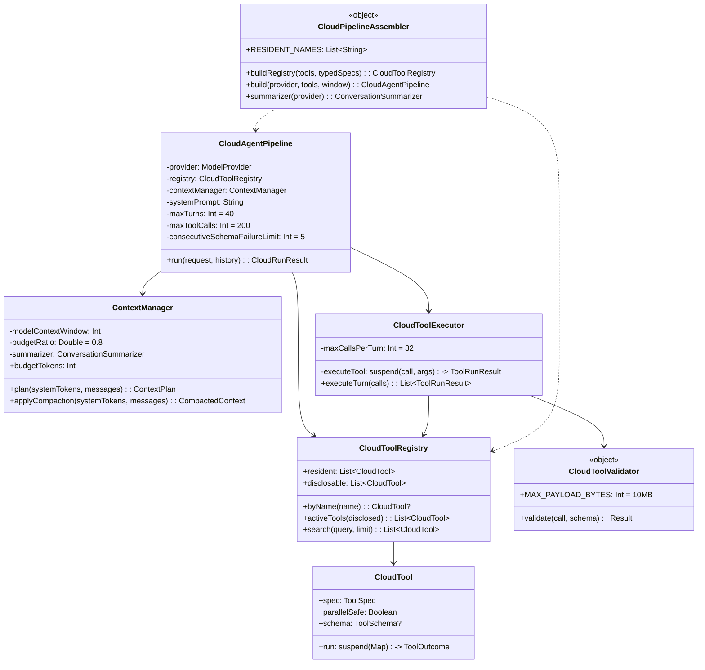

# CloudAgentPipeline 架构设计

> **版本**：2026-10-21 · 为 2026 世代云端大模型（Claude Opus 5.5 / GPT-6 Astra 级）设计
> **定位**：**隔离重建**的新执行管线。旧 `AgentLoop` 保留为 fallback，通过 Feature Flag 切换。
> **原则**：不修补小模型时代的 Hack，而是**新建一条没有它们的路**。

---

## 0. 为什么必须"隔离重建"而不是"局部修补"

旧代码不是"有 bug"，而是**为一类已不存在的模型做的工程妥协**。局部修补会遇到三个结构性问题：

| 问题 | 局部修补会撞上的墙 |
|---|---|
| **文本轨与原生轨并存** | 提示词教 JSON 信封、解析器认 CDATA、UI 靠 `{"tool"` 前缀判流式 —— 这三处互锁。删一处，另两处就失去意义 |
| **类型信息在 55 个参数里已丢失** | `ToolParam.type` 只能表达 string。要支持 integer 就得改 `ToolSpec` → 改 `PrefixBuilder` 手工序列化 → 改 `NativeToolSchema` → 改 3 个 provider |
| **781 个测试钉住了旧行为** | 直接替换会让"改测试锚点"与"暴露真问题"混在一起，无法分辨 |

⇒ 新管线**独立成包** `dev.heracles.cloud`，旧路径零改动，Flag 切换。

---

## 1. 目录结构

```
core/src/main/kotlin/dev/heracles/core/tool/
├─ CloudToolSchema.kt          ★ 新建 · 类型化参数（integer/boolean/array/enum）+ 确定性序列化
├─ ToolSpec.kt                 ✎ 追加 1 个可选字段 jsonSchema（默认 null ⇒ 旧路径零回退）
├─ ToolValidator.kt            ✎ 旧路径：删除 500 字符白名单（fixer-core 并入）
└─ （其余不动）

agent/src/main/kotlin/dev/heracles/cloud/     ★ 全新包，与 agent/*.kt 完全隔离
├─ CloudAgentPipeline.kt       ★ 管线主体：循环 / 并行执行 / 配对回填 / 熔断
├─ CloudPipelineFlags.kt       ★ Feature Flag（env: HERACLES_CLOUD_PIPELINE）
├─ CloudPipelineAssembler.kt   ★ 装配：复用旧 AgentTool 执行体，重建类型化声明
├─ context/
│  └─ ContextManager.kt        ★ 模块二：token 预算装载 + 摘要压缩
├─ tool/
│  ├─ CloudToolRegistry.kt     ★ 模块一/五：常驻队列 + 可检索（不再"披露才可用"）
│  ├─ CloudToolExecutor.kt     ★ 模块一：并行执行 + 未执行配对回填
│  └─ CloudToolValidator.kt    ★ 模块三：JSON Schema 校验 + 唯一 10MB 物理闸
└─ prompt/
   └─ CloudPrompts.kt          ★ 模块四：无"教练三连"的系统提示词

agent/src/main/kotlin/dev/heracles/agent/tools/
└─ CloudGlob.kt                ★ 新建：完整 glob（[abc] / {b,c} / [a-z] / [!abc]）

toolchain/src/main/kotlin/dev/heracles/toolchain/
└─ BoundedReader.kt            ★ 新建：流式有界读取（物理防 OOM）

provider-http/src/main/kotlin/dev/heracles/provider/http/
└─ NativeToolSchema.kt         ✎ canonicalBody 优先用 jsonSchema（null 时逐字节回退）
```

**隔离边界**：`dev.heracles.cloud.**` 不 import 任何 `dev.heracles.agent` 的类型，
除了 `AgentTool`（执行体复用）与 `ToolOutcome`（结果映射）。
⇒ 删掉整个 `cloud/` 包，旧管线不受影响。

---

## 2. 类图



---

## 3. 数据流（一轮）

```
                    ┌──────────────────────────────────────┐
                    │ session: List<AgentMessage>           │
                    │ (append-only，永不改写)                │
                    └───────────────┬──────────────────────┘
                                    │
                    ① ContextManager.applyCompaction(systemTokens, session)
                                    │
                    ┌───────────────▼──────────────────────┐
                    │ 预算 = modelContextWindow × 0.8       │
                    │ 装得下 ⇒ 全装（不做"保留 N 轮"）        │
                    │ 装不下 ⇒ 丢最旧 + 摘要（预算≥4096）     │
                    └───────────────┬──────────────────────┘
                                    │  ChatMessage[] + tools(JSON Schema)
                    ② provider.generateStream(...)
                                    │
                    ┌───────────────▼──────────────────────┐
                    │ done.toolCalls 为空？                 │
                    └───┬───────────────────────┬──────────┘
                        │是                     │否
              ┌─────────▼─────────┐   ┌─────────▼──────────────────┐
              │ 正文 = 最终回答     │   │ ③ 元工具先处理（search_tools）│
              │ **不需要 JSON 信封** │   │ ④ 其余**并行**执行           │
              └───────────────────┘   └─────────┬──────────────────┘
                                                │
                                  ⑤ 每个调用回填一条 tool_result
                                     （含未执行的 ⇒ 避免 400）
                                                │
                                  ⑥ 连续 Schema 失败 ≥5 ⇒ 熔断
                                     （把具体错误喂回模型，不猜）
```

---

## 4. 五个模块的设计决策

### 模块一：原生工具调用

| 决策 | 旧 | 新 | 理由 |
|---|---|---|---|
| 输出解析 | `AgentOutputParser`（CDATA + 信封 + 正则） | **无解析器** | provider 已把分片拼装好，语义层不该再解一遍自由文本 |
| 参数类型 | 55 个全 `string` | JSON Schema 真实类型 | 模型看 `integer` 才填 `200` |
| 并行 | 上限 4，两段式 preFetch | 上限 32，全部 `async/awaitAll` | 成本闸而非能力闸 |
| 参数错误 | `toString()` 抹平 + 正则修 | **抛具体 Schema 错误** | 模型能自愈；掩盖真因更糟 |

### 模块二：上下文

| 决策 | 旧 | 新 |
|---|---|---|
| 历史 | `HISTORY_MAX_TURNS=10` 硬切 | 预算内**全装** |
| 触发 | 轮数 | token 估算 > 80% |
| 摘要预算 | 1024（思考吃光 ⇒ 静默失效） | **≥4096** |
| 摘要失败 | 保持原会话 | 保持原会话 + **如实标记** |

### 模块三：校验

删除 4 条规则中的 2 条"断头台"（500 字符、空值一刀切），保留 2 条（必填/未知参数），
新增 **Schema 类型校验**，唯一物理闸 **10MB**。

### 模块四：提示词与熔断

- 系统提示移除"2 步以上 / 一次只做一步 / 3000 字符分段"
- 熔断阈值 2 → **5**
- 摘要 `max_tokens` 1024 → **4096**
- 硬停文案从"判定任务已完成"改为"任务**未完成**，如实说明"

### 模块五：常驻队列 / UI / glob

- `edit` 与 `apply_patch` **都**常驻（旧 12 格把 edit 挤走）
- 审批弹窗**不截断**（正文给全文，摘要行才截）
- glob 支持 `[abc]` / `{b,c}` / `[a-z]` / `[!abc]`

---

## 5. 明确保留的安全底线

| 底线 | 位置 | 为什么不能删 |
|---|---|---|
| 温度/电量熔断 | `Contract.Thermal` | **用户明确要求保留**。设备保护，不是模型限制 |
| 前台服务防杀 | `AgentBuildService` | 同上 |
| 物理防 OOM | `BoundedReader`（**新**，替换 `readAllBytes`） | 用户明确要求：流式读，禁止全量入内存 |
| 危险命令拦截 | `CommandGuard` | kill/force-stop 是 `AGENTS.md` 硬约束；SSRF 是真实风险 |
| **未执行配对回填** | `CloudToolExecutor` + pipeline ⑤ | 否则下次请求 **400**。这是 wire 语义 |

---

## 6. 切换方式

```kotlin
// 方式 1：环境变量
HERACLES_CLOUD_PIPELINE=1

// 方式 2：代码显式
CloudPipelineFlags.override = true
CloudPipelineFlags.isCloudPipeline()   // 装配层据此选管线
```

**默认关闭** —— 与旧代码"零回退"纪律一致：未验证的新管线不会意外影响现有用户。

---

## 7. 已知未验证项（如实声明）

1. **真 Key 未验证** —— `AGENTS.md` 明确记录「真 Key 验证一次都没跑过」。
   新管线改了 `tools` 的 schema 形状，**必须真 Key 跑一轮**才算完成。
2. **`count_tokens` 未接** —— `ContextManager` 用 `TextMath.estimateTokens` 估算，
   `实测-08` 记录该估算曾 **+40% 高估**。生产环境应接 provider 的 tokenizer。
3. **UI 未接新管线事件** —— `CloudEvent` 与旧 `AgentEvent` 是两套；切换时需要适配层。
