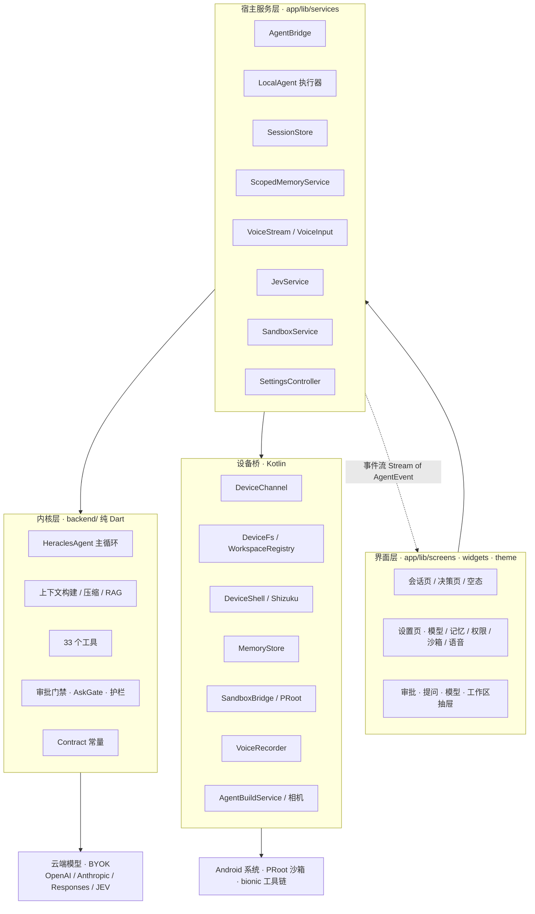
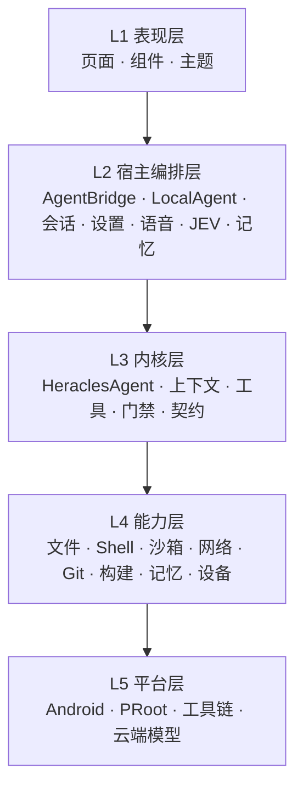
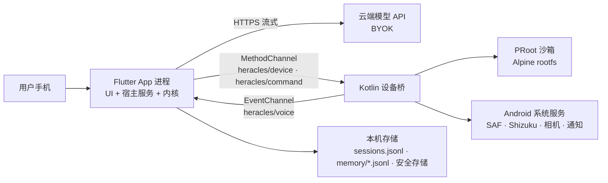
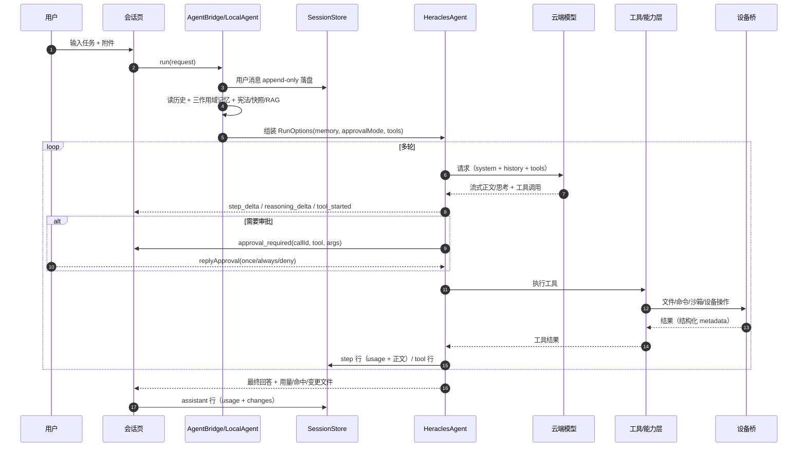
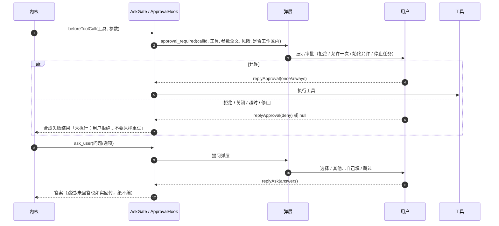
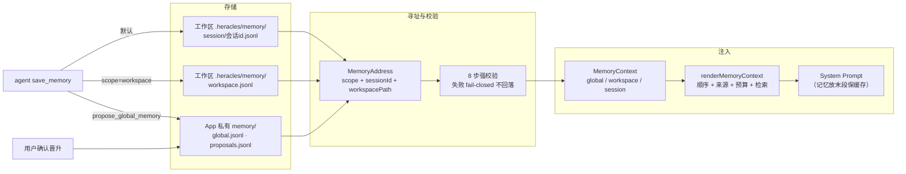
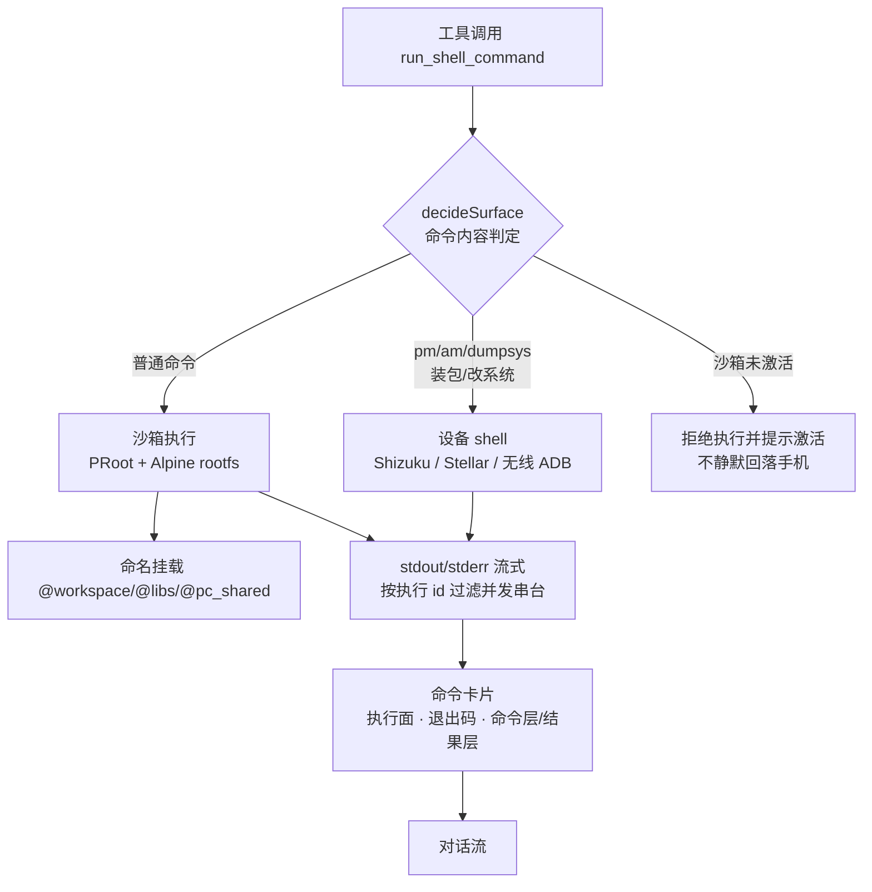
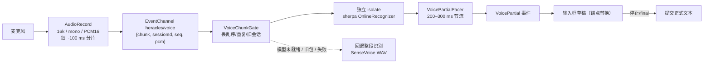
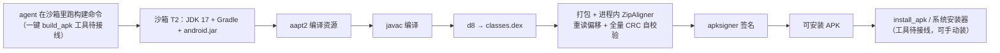

# Heracles

**手机上的开发智能体** —— 一个跑在 Android 上的 AI 编程 App。

你打字描述一个需求，它在你手机上的**真实工作区**里读代码、改文件、跑命令；
接上内置沙箱或设备工具链之后，它还能**直接在这台手机上**编译、重打包、签名并安装 APK。
模型用**你自己的 API Key**（BYOK）跑在云端，手机上不加载聊天模型；本地只跑语音识别与（可选的）JEV 小模型文件。

> **源码版本 v0.3.1**（Releases 最新发布 v0.2.2） · **Android 12（API 31）+** · **arm64** · **GPL-3.0** · 内核 `backend/` 为纯 Dart（384 项单测）
>
> 📖 图文简介与快速开始：**https://theohowie.github.io/Heracles/**
> ｜ ⬇️ [**Releases（APK 下载）**](https://github.com/theohowie/Heracles/releases)
> ｜ 📄 接口契约：[docs/INTERFACE.md](docs/INTERFACE.md) · [docs/接口.md](docs/接口.md) · 设计语言：[docs/DESIGN.md](docs/DESIGN.md)
>
> **alpha 阶段**：接口、UI、工具面都还会变。能用的与还不能用的，见 [已知限制与未验证](#10-已知限制与未验证)。

---

## 目录

- [1. 它是什么](#1-它是什么)
- [2. 功能全景](#2-功能全景)
- [3. 架构](#3-架构)
- [4. 数据流](#4-数据流)
- [5. 关键机制](#5-关键机制)
- [6. 快速开始](#6-快速开始)
- [7. 从源码构建与测试](#7-从源码构建与测试)
- [8. 目录结构](#8-目录结构)
- [9. 文档与接口](#9-文档与接口)
- [10. 已知限制与未验证](#10-已知限制与未验证)
- [11. 安全模型与注意事项](#11-安全模型与注意事项)
- [12. 许可与致谢](#12-许可与致谢)

---

## 1. 它是什么

Heracles 把「一个编码智能体」塞进手机：**对话 → 计划 → 调工具 → 审批 → 执行 → 回读 → 汇报**，
全部在 App 内完成；工作区可以是手机上的任意 SAF 目录，也可以是 App 私有的默认工作区。

| 场景 | Heracles 怎么帮你 |
|---|---|
| **手边没有电脑，想改几行代码** | 把项目目录加成工作区，说清要改什么；它读文件、局部替换、改完把 diff 给你看 |
| **想让 AI 带着上下文看代码** | 工作区文件可列、可读、可按文件名/内容搜索；长文件分段；行号/片段可追溯 |
| **想在这台手机上构建 APK** | 沙箱内编译环境（T2：JDK 17 + Gradle + android.jar）就绪后，agent 可在沙箱里跑构建命令产出可安装 APK（已验证可编出并签名）；一键 `build_apk` 工具仍待接线 |
| **想改一个现成的 APK** | 反编译/重打包/签名的**专用工具尚未接线**（调用会明确报「未接线」，不假装成功）；沙箱内可手动跑相关命令，但未产品化 |
| **长任务需要看得见、管得住** | 任务计划（待办/灵动岛）、主动提问、审批弹层（拒绝/允许一次/始终允许/停止）、随时取消、预算预警 |
| **想让它记得住** | 三层记忆：会话私有 / 工作区共享 / 全局只读（模型只能提议，你确认后才全局生效） |
| **只是想有个手机上的编程助手** | 不带工作区也能聊；多轮工具调用、流式输出、上下文压缩、用量与缓存可见 |

**它不是什么**：不是把模型下载到手机里跑（聊天模型始终在云端，BYOK）；不是「安全沙箱」——
沙箱是**执行面隔离与可回滚**，不是对抗恶意代码的强隔离（见 [11. 安全模型](#11-安全模型与注意事项)）。

---

## 2. 功能全景

### 2.1 智能体运行时

| 能力 | 说明 |
|---|---|
| **工具循环** | 模型产出工具调用 → 宿主执行 → 结果回填 → 继续，直到给出最终回答（`ContractAgent.maxTurns` 上限，默认 40，用户可调） |
| **任务计划** | `write_todos` 产出/更新计划，界面按**真实工具执行结果**逐步打勾；灵动岛收起态是步骤数字轨道（当前步黄色、完成绿色、可横向跟随） |
| **流式输出** | 正文按 ~4 字小片平滑；思考与正文分离（`reasoning_delta` / `step_delta`）；可开关 |
| **停止 / 排队 / 插队** | 真取消（掐断在途流式请求，框架在轮次/工具边界停）；繁忙时可排队发送或中断 |
| **上下文压缩** | 三级（micro 清理老工具结果 / auto LLM 摘要 / full 确定性重置），压缩事件可见；压缩前写结构化笔记 |
| **工作区上下文** | 自动注入工作区宪法（`AGENTS.md`/`CLAUDE.md`/`README.md`，上限 20000 字符、截断明说）+ 文件树快照（≤200 项）+ 词法 RAG 检索（带文件:行号出处） |
| **热保护与前台服务** | 长任务期间前台服务保活、通知栏显示进度；设备温度 ≥44 °C 主动暂停（设计行为，不是崩溃） |
| **AskGate 主动提问** | 选项式多题（单选/多选/「其他…自己填」），提交/跳过/误关都有明确语义；超时按「未回答」如实回模型 |
| **审批门禁** | 三档：手动审批 / 工作区内修改 / 完全访问；NeedsApproval 真挂起，fail-closed；超时 5 分钟按拒绝 |
| **命令卡片** | 工具事件带结构化执行面（沙箱/手机）、退出码、命令；展开为双层卡（命令层/结果层），复制命令+清洗后的结果全文 |
| **子代理 / 技能** | 框架提供 `delegate_task`（隔离子任务，只回结论）与 `activate_skills`（按需加载技能全文）；App 显式开启 |
| **预算与失败处理** | 工具调用预算 75%/90% 预警；模型失败可按配置降级到备用模型；拒绝/未回答不编造 |

### 2.2 工具面（33 个内核工具 + 框架计划工具）

工具按**能力白名单**装配：缺能力时工具「调用即失败并说明原因」，不会假装成功。
另有框架增强工具（计划 `write_todos`、子代理 `delegate_task`、技能 `activate_skills`），按开关启用；`write_todos` 不在 33 个内核工具内。

| 类别 | 工具 |
|---|---|
| **文件与搜索（11）** | `list_files` `read_file` `write_file` `edit` `apply_patch` `find_files` `grep_files` `mkdir` `delete_path` `move_path` `copy_path` |
| **命令与设备（2）** | `run_shell_command`（执行面自动路由：沙箱 / 设备 shell）· `check_device_state` |
| **交互与记忆（3）** | `ask_user` · `save_memory`（默认写会话私有，可指定工作区）· `propose_global_memory`（全局只读，只能提议） |
| **网络（1）** | `web_fetch`（SSRF 闸 + 注入包裹） |
| **Git（11）** | `git_status` `git_log` `git_diff` `git_branches` `git_show_commit` `git_stage` `git_unstage` `git_commit` `git_checkout` `git_push` `git_init` |
| **构建与逆向（5）** | `build_apk` `apk_decompile` `apk_recompile` `apk_sign` `install_apk` —— ⚠️ 工具存在，但当前发行版 **APK 能力未接线**：调用会明确返回「尚未接线」并说明原因（不假装成功）；沙箱内可手动跑构建命令 |

> 计划能力由框架的 `write_todos` 提供（计划状态与历史分离、`plan_updated` 完整帧驱动 UI）。

### 2.3 执行面：沙箱 / 设备 shell / 构建

| 执行面 | 在哪跑 | 身份 | 用途 |
|---|---|---|---|
| **沙箱**（PRoot + Alpine rootfs） | APK 内联的 rootfs | 沙箱内假 root | 跑项目构建/脚本；产物、缓存、半成品都留在 rootfs，可整块回滚 |
| **设备 shell**（Shizuku / Stellar / 无线 ADB） | 真实手机 | App / Shizuku / Root | 操作真实系统：装包、读系统文件、`pm`/`am`/`dumpsys` 等 |
| **设备工具链**（Termux bionic） | 真实手机 | App UID | 可选的设备侧 `openjdk-17` / `aapt2` / `d8` / `apksigner` / `smali` 前缀树 |

- 沙箱 **T0（基础 rootfs，约 9 MB，内置离线）** 随装随用；**T1（常用构建工具）** 内置；
  **T2（JDK 17 + Gradle + android.jar，约 415 MB）** 需要你主动下载（会先确认体积）。
- **注意**：T2 只是「编译环境」；`build_apk` 等专用构建工具当前未接线（见 [10. 已知限制](#10-已知限制与未验证)）。
- 沙箱支持命名挂载 `@workspace` / `@libs`（只读）/ `@pc_shared` 等；命令与 UI 只出现 `@name`，物理路径由宿主解析。
- 路由不由模型决定：`run_shell_command` 不暴露 `surface` 参数，宿主按命令内容判「要动 Android 本身」才落设备 shell。

### 2.4 安全与审批

| 档位 | 行为 |
|---|---|
| **手动审批** | 写文件/编辑/建目录/破坏性操作/shell/APK 工具都先弹审批；参数全文可滚动查看 |
| **工作区内修改** | 工作区内写/编辑/建目录放行；破坏性三件套（删/移/复制）与 shell/APK 仍拦 |
| **完全访问** | 不弹审批（风险页二次确认后生效）；仍受 shell 硬禁令与 SSRF 等恒定闸约束 |

- 审批弹层：**拒绝 / 允许一次 / 始终允许**，另有「停止任务」；「始终允许」按**工具名**持久化（`SharedPreferences`），可撤销。
- 关闭弹层/返回键/遮罩 = 明确二次确认后按「拒绝/未回答」处理（不会静默放行，也不会悄悄丢掉）。
- 运行中切档：**对下一次运行生效**（本轮快照不变），界面会提示。

### 2.5 记忆系统（三层作用域）

| 作用域 | 绑定 | 谁能写 | 注入范围 |
|---|---|---|---|
| **会话私有** | `(workspacePath, sessionId)` | agent（`save_memory` 默认）+ 用户 | 只在该会话 |
| **工作区** | `workspacePath` | agent + 用户 | 该工作区所有会话 |
| **全局（只读）** | App 级 | **仅用户**；agent 只能 `propose_global_memory`，用户确认后晋升 | 所有会话 |

- **寻址强校验（fail-closed）**：读/写都带 `scope + sessionId/workspacePath`；伪造/不存在的会话、路径不匹配一律拒绝，**绝不回落全局**。
- **存储与注入两套预算**：存储软预算（global 8 MB / workspace 16 MB / session 512 KB）+ 淘汰；注入预算（全局+工作区 6000 字符 / 会话 4000 字符，按模型窗口 5% 自适应），按任务检索、整条取舍、超预算声明「另有 N 条未注入」。
- **原子改写**：删除/清空写墓碑（tombstone）+ compact，不再「清空文件 + 逐条重写」。
- **迁移**：旧单文件 `memory.md` 一次性迁入 global（先备份、幂等、不丢条目）；旧记忆页的新增/编辑会明确提示过渡态。
- **安全**：疑似密钥/令牌拒收入口不变（SEC4 双闸）。

### 2.6 JEV 决策引擎

- **定位**：是非题决策模型（不是聊天模型），给「推荐/不推荐 + 置信度」；理由由当前对话模型补写。
- **云端**：直连平台 `/v1/decision` 兼容接口（推荐 `https://tokenrhythm.studio/v1/decision`；填到 `/v1` 自动补全），模型固定 `NeoHorse-Jev-4B`，Bearer `sk_`。
- **诊断**：测试连接返回可诊断对象（实际 URL / HTTP 码 / 服务端 `code/message/traceId` / 原始响应体脱敏 / 模型纠正 / hint）；**仅首次 422 重试一次**，重试题键仍是 `recommend`。
- **本地档位**：0.8B / 2B GGUF 模型可下载管理；**本地推理引擎尚未接入**（预留 `AgentBridge.jevLocalDecide`，未接入时界面如实提示）。
- **真 Key 状态**：用户 2026-10-29 在 App 内用真 Key 实测通过（口述证据）；本仓库未保留独立真调用证据。

### 2.7 语音输入

- **整段识别**：SenseVoiceSmall（ONNX，约 231 MB）本地离线识别；录完 → 识别 → 插入输入框光标处。
- **流式识别（边说边填）**：streaming zipformer 中英双语 int8（约 200 MB）本地增量解码；
  Kotlin `AudioRecord` 每 ~100 ms 推 PCM 分片 → Dart 排序门 → 独立 isolate `OnlineRecognizer` → 200–300 ms 节流 → 输入框草稿；停止提交、取消恢复原文。
- **隐私**：音频只在设备本机处理，不上传云端；模型未就绪/旧机型自动回退「录完再识别」。
- **权限**：麦克风统一在「设置 → 设备权限」申请。

### 2.8 输入、附件与相机

- 文本输入条：模型/思考档位胶囊、权限盾牌、麦克风、附件、发送/停止/排队；发送键三态。
- 附件：文件、图片、拍照（相机五级兜底，兼容 MIUI 不写 `EXTRA_OUTPUT`）；图片压缩后以 base64 多模态块发给支持视觉的模型（按模型名判断，未知模型如实降级）。
- 已发送图片可点开看大图；长文本/长结果可选折叠。

### 2.9 工作区、会话与 Git/GitHub

- **工作区**：SAF 目录授权或 App 私有默认工作区；多工作区切换；工作区行长按可新建会话/移除；
  SAF 工作区受系统限制（Android 11+ 不能直接读某些目录），App 会给出可操作的出路。
- **会话**：严格 append-only `.jsonl`（缓存前缀纪律）；列表/星标/归档/重命名/删除；会话激活先恢复计划与历史。
- **Git**：11 个工具（状态/日志/差异/分支/暂存/提交/检出/推送/初始化）；面板可视化。
- **GitHub**：Device Flow 登录（token 只进安全存储与请求头），仓库克隆/连接面板。

### 2.10 用量、缓存与上下文

- 顶栏双指标：上下文占用环 + 缓存命中率；用量抽屉含「缓存命中（累计·加权）/ 稳态（轮次平均）/ 输入·命中·未命中·输出」。
- 逐轮 usage 落盘到会话（step 行 + assistant 行）；缓存命中可事后复算。
- 审批/提问决策也落盘（`role: approval/ask`，含 timeout/cancelled/empty 如实语义），授权可审计。
- 上下文分项（system / toolDefs / toolResults / reasoning / assistant / user / summary）+ 上限来源可见。

### 2.11 模型接入（BYOK）

| 能力 | 说明 |
|---|---|
| 协议 | `OpenAI 兼容` / `Anthropic` / `Responses`（只有 OpenAI 兼容轨做过真 Key/真机验证） |
| Base URL | 任意 OpenAI 兼容端点、自建 vLLM、中转站 |
| API Key | 只存手机安全存储；只出现在请求头；日志/异常/URL 全部脱敏 |
| 模型目录 | `GET {baseUrl}/models` 拉列表与上下文长度；未知长度如实显示 |
| 思考档位 | auto/off/low/high/max（只有 OpenAI 兼容轨真实生效，其余轨如实降级显示） |
| 降级 | 主模型失败可切备用模型序列（预算超限不降级） |

### 2.12 界面与设置

- **设计语言**：黑白简约 + Cupertino 化；弹性开关、分段按钮、回弹按钮、上拉抽屉、毛玻璃轻提示；浅色/深色主题与玻璃效果。
- **会话页**：两层顶栏（品牌 + 会话名 + 双指标）、灵动岛、对话/工具卡、输入区。
- **设置**：通用（语言/字号/工作步骤/繁忙发送/最大轮次/流式/默认权限）· 模型与提供商 · JEV 决策引擎 · 语音识别 · 沙箱（T2 编译环境）· 设备权限 · 记忆（三作用域）· 已归档对话 · 已始终允许的工具 · 外观 · 关于/开源许可。

---

## 3. 架构

### 3.1 架构总览



### 3.2 分层与依赖规则



依赖方向是**单向**的：UI 只依赖宿主服务层；内核不依赖 Flutter、不依赖 Android，可在 PC 上 `dart test`；
设备能力通过 `Capabilities` 抽象注入，缺能力时工具「调用即失败并说明原因」。
两条硬规则：**`backend/` 不得 import `package:flutter/*`**；**UI 不直接碰通道/文件系统**（一律经宿主服务层）。

### 3.3 运行时拓扑



---

## 4. 数据流

### 4.1 一次任务的主链路



### 4.2 审批与主动提问



### 4.3 记忆：三层作用域与注入



### 4.4 工具路由与沙箱执行



### 4.5 流式语音



### 4.6 构建 APK



> ⚠️ 当前发行版的 `build_apk` / `apk_*` 专用工具**未接线**（`ApkCapability` 返回「尚未接线」），
> 沙箱 T2 只提供**编译环境**；agent 可以用 `run_shell_command` 在沙箱里跑等价的构建命令，但不是一键产品能力。

---

## 5. 关键机制

| 机制 | 做法 | 为什么 |
|---|---|---|
| **会话 append-only** | `.jsonl` 只追加、不改既有字节；工具/计划/step/usage 都是行 | 前缀缓存命中稳定（实测长任务 90–99%），分支/改写会让命中率不可预测 |
| **计划是权威帧** | `plan_updated` 每次发完整帧，前端只读最后一帧 | 避免增量拼接漂移；完成/中断/取消都有明确终态 |
| **审批 fail-closed** | 拿不到「允许」就不执行；超时/断开/无 UI 都按拒绝；拒绝结果明确回给模型 | 抗幻觉靠架构，不靠提示词劝 |
| **工具白名单 + 参数门禁** | 三态 Allow/NeedsApproval/Deny；解析失败绝不猜；缺能力即失败并说明 | 模型不能通过编参数绕过 |
| **上下文压缩分级** | 40% micro / 60% auto 摘要 / 80% full 重置，压缩前写笔记 | 长会话不爆窗、不丢关键结论 |
| **记忆作用域** | session/workspace/global；强校验寻址；全局只读+提议晋升 | 防串台（复制工作区/池化/sessionId 传错），全局不被模型污染 |
| **沙箱边界** | PRoot rootfs 可回滚；不提供 namespace/cgroup/seccomp | 隔离文件系统污染与崩溃恢复，**不是**敌对代码隔离 |
| **密钥安全** | 安全存储；只进请求头；错误/日志/URL 脱敏；SEC4 拒收疑似密钥 | BYOK 场景下密钥泄露即事故 |
| **沙箱/设备不合并** | UI 与工具都分开标注「沙箱 / 手机」 | 误把真实系统当沙箱会出事故 |

---

## 6. 快速开始

### 6.1 安装

从 [Releases](https://github.com/theohowie/Heracles/releases) 下载 APK。
**Releases 当前最新发布为 v0.2.2；仓库主线源码已到 v0.3.1**（0.3.1 的 APK 可按下文自建；发布后这里会更新下载链接）。
要求 **Android 12（API 31）及以上**、**arm64（arm64-v8a）** 手机。
当前 release 包使用 debug 密钥签名，安装时需要允许「未知来源」；换正式密钥前不能覆盖升级。

### 6.2 配置模型（BYOK）

`设置 → 模型 → 添加`：

| 字段 | 说明 |
|---|---|
| **API 协议** | `OpenAI 兼容`（最常用）/ `Anthropic` / `Responses` |
| **Base URL** | 例如 `https://api.deepseek.com/v1`、`https://dashscope.aliyuncs.com/compatible-mode/v1`，也可自建 vLLM 或中转站 |
| **API Key** | 只存在手机本地（安全存储），只出现在请求头，不进日志 |
| **模型名** | 可点「获取可用模型」从 `GET {baseUrl}/models` 拉列表 |

> 建议选支持 **function calling** 的模型：原生工具调用是验证过的那条路；不支持的模型会退到文本 JSON 协议（能跑，稳定性差一截）。

### 6.3 加工作区，开聊

侧边栏 `⊕` 两个入口：**选择文件夹**（SAF 授权任意目录）或 **默认工作区**（App 私有目录，免授权）。
输入任务 → 模型先计划再执行；越界动作按权限档处理；长任务可在通知栏看进度、在灵动岛看步骤。

### 6.4 可选：沙箱与构建

- 沙箱 **T0 rootfs 内置**，命令默认跑在沙箱；`设置 → 沙箱` 可看状态、挂载点、重置。
- 要「从源码编 APK」：在 `设置 → 沙箱 → 编译环境` 下载 **T2（约 415 MB）**；或在设备上部署 Termux bionic 工具链（装配脚本不随仓库发布）。
- 要在真实手机上执行系统级命令：装 **Shizuku**，在 `设置 → 设备权限` 一键授权。

### 6.5 可选：语音

`设置 → 语音识别` 下载 SenseVoice（整段识别，约 231 MB）；要「边说边填」再下载流式 zipformer（约 200 MB）。
两者都是**本机离线**，录音不上传。麦克风权限在「设备权限」页统一开。

### 6.6 可选：JEV 决策

`设置 → 模型 → JEV 决策引擎`：地址填 `https://tokenrhythm.studio/v1`（或完整 `/v1/decision`），
模型固定 `NeoHorse-Jev-4B`，粘贴平台 Key；「测试连接」会显示实际请求 URL 与服务端诊断。
本地 0.8B/2B 档位可下载模型文件，但**本地推理引擎尚未接入**。

---

## 7. 从源码构建与测试

**要求**：Flutter 3.47.7（Dart SDK `^3.12.2`；本机实测 Dart 3.13.5）· JDK 17 · Android SDK（`compileSdk 37` / `minSdk 31`）· adb。
`backend/` 是**纯 Dart 包**，不需要 Flutter、不需要 Android。

```bash
# 1) 内核（编排 / 工具 / 契约 / 记忆 / 提示词）—— 纯 Dart，最快最稳
cd backend
dart test                      # 384 项（当前主线实测全绿）

# 2) App 静态检查
cd ../app
flutter pub get
flutter analyze                # 期望：No issues found!

# 3) 组件测试（建议逐文件跑）
flutter test test/command_card_wiring_test.dart
flutter test test/dynamic_island_step_track_test.dart
flutter test test/permission_switch_test.dart
flutter test test/memory_scope_test.dart
flutter test test/voice_stream_test.dart
# ……其余 60+ 个测试文件同理

# 4) 打包 / 装机
flutter build apk --release --target-platform android-arm64
adb install -r build/app/outputs/flutter-apk/app-release.apk
```

> ⚠️ **本机环境注意**
> - 同一时刻只允许一个 `flutter` 进程（`build` 与 `test` 会互抢 `app/.dart_tool/`）。
> - 本机偶发 loopback 被拒（`errno 10013`）或一次跑多个测试文件时 `loading` 失败 ⇒ **逐文件跑**并重试；这不是产品失败。
> - 判构建成败必须三件套：退出码 + 产物 mtime/sha256 + `√ Built …`（包装进程退出码会骗人）。
> - 改了 Kotlin 必须真编一次 `flutter build apk --debug`，`flutter analyze` 只看 Dart。

**本轮集成门禁（2026-10-30 实跑）**：`backend` **384/384** 全绿；`flutter analyze` **No issues found!**；
本轮新增的 **20 个前端测试文件**逐文件跑全绿（合计 **239** 条用例）。
`flutter test` 全量仍受本机多文件并发加载与历史 mock 死传输文件影响，按 AGENTS 约定逐文件跑。

---

## 8. 目录结构

```
Heracles/
├── backend/                纯 Dart 内核（不依赖 Flutter/Android）
│   ├── lib/src/agent/      主循环、会话历史、工具装配、子代理/技能接线
│   ├── lib/src/capability/ 能力抽象：文件、shell、沙箱、网络、Git、构建、记忆
│   ├── lib/src/context/    上下文构建、压缩、工作区索引、记忆上下文
│   ├── lib/src/contract/   所有魔法数字（ContractXxx）
│   ├── lib/src/guard/      护栏：shell 禁令、SSRF、注入包裹、预算
│   ├── lib/src/prompt/     人设/系统提示/技能/记忆渲染
│   ├── lib/src/tools/      33 个工具的实现与 schema
│   ├── test/               384 项单测
│   └── tool/               Headless CLI 与评测跑分器
├── app/                    Flutter App
│   ├── lib/screens|widgets|theme   UI（前端线）
│   ├── lib/services/       宿主服务层：AgentBridge、LocalAgent、会话、记忆、语音、JEV、设置
│   ├── test/               63 个组件/服务测试文件
│   └── android/            Android 壳 + Kotlin 设备桥（bridge/ 17 个 .kt + MainActivity）
├── sandbox/                端侧执行沙箱（PRoot + rootfs，fork 自上游项目，见 THIRD_PARTY_NOTICES）
├── core/                   编排框架源码（vendored 自上游，MIT；见 core/VENDOR.md）
├── docs/                   对外文档：DESIGN.md · INTERFACE.md · 接口.md
├── THIRD_PARTY_NOTICES.md  第三方代码版权与许可
└── LICENSE                 GPL-3.0
```

**分支约定**：`master` = 内核 + App 服务层 + 测试基建（主分支）；`frontend` 曾用于 UI 并行迭代，现已合入 `master`。
**站点**（落地页）不在上述目录：只在 `gh-pages` 分支（根目录产物 + `_source/` 源码）。

---

## 9. 文档与接口

| 文档 | 内容 |
|---|---|
| [docs/DESIGN.md](docs/DESIGN.md) | 设计语言：色板、字阶、圆角/间距、核心组件、输入单元、卡片与页面、语义色、退役清单 |
| [docs/INTERFACE.md](docs/INTERFACE.md) | **前后端接口唯一权威**：事件流、运行 API、审批/提问、计划、上下文统计、记忆三作用域（N7/N12）、流式语音（N13）、JEV（N11）、沙箱（§8） |
| [docs/接口.md](docs/接口.md) | 同一契约的后端实现面清单（RunOptions / Capabilities / 事件 / 时序） |
| `.docs/`（本机私有，不进仓库） | 实测台账、WORKLOG、分诊/提示词、决策记录 |

**变更规矩**：任何 wire 变更（字段/事件/通道方法/工具 metadata/`.jsonl` 行类型）先改 `docs/INTERFACE.md`；
未真 Key/真机验证过的标「未验证」，不许写成已完成。

---

## 10. 已知限制与未验证

| # | 限制 / 未验证 | 影响 |
|---|---|---|
| 1 | **只支持 arm64** | Flutter 引擎只带 `arm64-v8a`；badging 里的 v7a/x86_64 只是插件 `.so`，32 位手机起不来 |
| 2 | **release 用 debug 密钥签名** | 能装能用、可覆盖同签名安装；不能上架 Play，换正式密钥需卸载重装 |
| 3 | **沙箱不是强隔离** | PRoot 无 namespace/cgroup/seccomp；只用于文件系统隔离与回滚，不用于运行不可信代码 |
| 4 | **JEV 本地推理未接入** | 本地档位只能下载模型文件；界面如实提示「引擎未接入」 |
| 5 | **JEV 真 Key 证据** | 用户口述在 App 内实测通过；本仓库无独立真调用留证（mock 覆盖 5 类错误码 + 归一化 + 422 重试） |
| 6 | **Anthropic / Responses 轨** | 协议已支持，但只有 OpenAI 兼容轨做过真 Key/真机验证；思考档位在这两轨不生效（界面降级显示） |
| 7 | **记忆三作用域** | 后端与单测完成；真机迁移/会话隔离/提议晋升的验收台账仍待补（`.docs/实测-18`） |
| 8 | **流式语音** | 需手动下载流式模型；模型未就绪/旧包回退整段识别；只在一种机型验证 |
| 9 | **机型覆盖** | 主要在 Android 17 / arm64 / 小米类 ROM 上验证；其它机型的温度、权限、SAF 行为无数据 |
| 10 | **算法与模型差异** | 云端模型能力差异大；不支持 function calling 的模型会退文本 JSON 协议 |
| 11 | **图片理解依赖模型** | 图片按 base64 多模态块发送；不支持视觉的模型只拿到附件说明，不会假装看懂 |
| 12 | **测试环境** | 本机 `flutter test` 多文件并发会偶发加载失败；后端 `dart test` 是主要门禁 |
| 13 | **语言** | 界面提供中/英切换；部分深层页面文案仍在收敛 |
| 14 | **沙箱与工作区仍是两套文件系统** | 阶段 1（工具描述/系统提示纠偏）已完成，模型不再用 shell 探测用户工作区；把 App 工作区 bind 进沙箱（D4）仍待产品拍板 |
| 15 | **历史会话的命令卡** | 实时链路已带真实执行面/退出码；落盘 `tool` 行补 `surface/exitCode/command`（D6）待拍板，否则重开会话只能按工具名回退猜 |

---

## 11. 安全模型与注意事项

- **BYOK，费用自负**：推理都走你自己的 Key；模型能力直接决定体验上限。
- **自动执行有风险**：它会在你授权的工作区里改文件、跑命令 —— 请只授权项目目录，别授权敏感目录。
- **权限最小化**：不主动申请「所有文件访问」；文件走 SAF 授权目录；不杀用户进程、不停 Shizuku、不改用户真实权限。
- **审批是最后一道闸**：高危操作先弹审批；拒绝/超时/断开一律不执行（fail-closed），并把「未执行」如实回给模型。
- **密钥与记忆**：Key 只进安全存储与请求头；记忆写入有密钥正则双闸；日志/异常/URL 脱敏。
- **沙箱**：产物可整块回滚；但**不提供敌对代码隔离**，不要把不可信代码当成「在沙箱里就安全」。
- **网络**：`web_fetch` 有 SSRF 闸；外部内容进模型前做注入包裹与边界声明。

---

## 12. 许可与致谢

**GNU General Public License v3.0**（见 [LICENSE](LICENSE)）。
再发布衍生作品时**必须同样以 GPL-3.0 开源**并提供源码。本项目按「现有状态」提供，**不含任何担保**。

第三方代码（`core/` 上游框架、`sandbox/` 上游沙箱、各 Flutter/Dart/Kotlin 依赖）的版权与许可见
[THIRD_PARTY_NOTICES.md](THIRD_PARTY_NOTICES.md) 与 App 内「设置 → 开源许可」。
特别感谢：Dart / Flutter / sherpa-onnx / SenseVoice / PRoot / Alpine 以及所有依赖作者。
